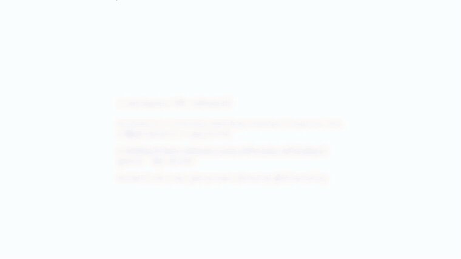
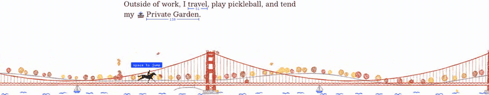
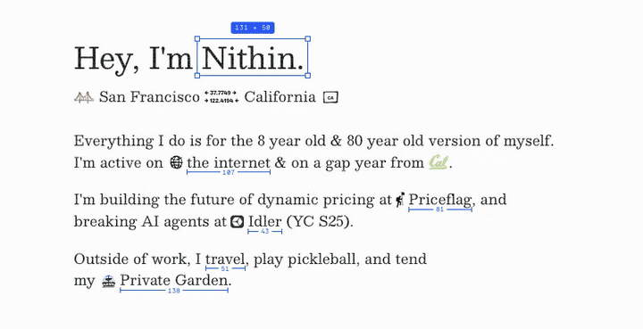
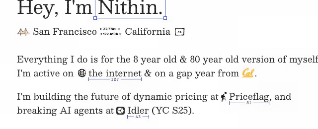
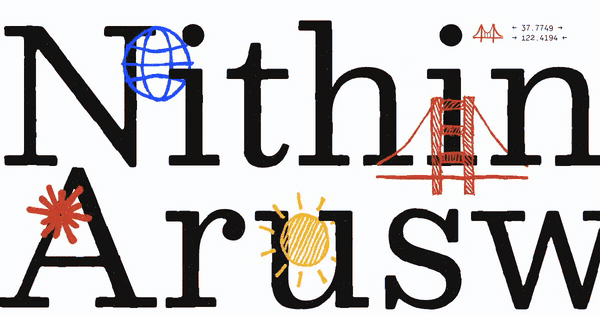

# nithinaruswamy.com

<p align="center">
  <a href="https://nithinaruswamy.com">
    
  </a>
</p>

<p align="center">
  My personal site. One page, nothing scrolls, and almost everything on it is drawn in code.<br />
  <a href="https://nithinaruswamy.com"><b>nithinaruswamy.com</b></a>
</p>

---

## What's on it

### A horse from 1878, running across the Golden Gate

<p align="center">
  
</p>

- **The horse** is Sallie Gardner, from Eadweard Muybridge's *The Horse in Motion* (1878, public domain). Eleven of his photographs, cut into one strip, played in a loop.
- **She runs for ever without going anywhere.** The bridge slides past at exactly the pace of her legs, and the far things (headlands, boats, Alcatraz) slide more slowly.
- **Press space to jump** (or tap on a phone). She sinks, pushes off, tucks, reaches and lands. Clear a pumpkin and a counter starts; clip one and it tips over.
- **It's autumn.** Leaves blow back the way she came, and the headlands are lined with trees.
- **The bridge is drawn, not an image.** Towers, cables, hanger ropes and water are all [rough.js](https://roughjs.com) strokes from fixed seeds, so they look hand-drawn and come out the same every time.

### An opening borrowed from a design tool

The page arrives the way a frame looks when you select it: cobalt measuring guides draw themselves around the text, colour sweeps through the words a line at a time, and the guides pull away. The name keeps its selection box, with its size in pixels on a label above it.

- **Click the name** and the label shuffles into "Email copied".
- **Every link is underlined with a dimension line**, capped at both ends, with its real length in pixels written on it.

### Previews that sharpen as they arrive

<p align="center">
  
</p>

Hover a link and a card of that site appears as a handful of big pixels, sharpens in six quick steps, then plays a short clip. It trails the pointer with a slight tilt, and the rest of the page blurs back.

### A dock of hand-drawn marks

<p align="center">
  
</p>

"The internet" opens into a row of drawn social marks that swell under the pointer, like a dock.

### Ink, not pixels

The text and the horse are run through SVG filters that wobble the edges and drop specks out of the ink, so type looks printed. The horse gets a different printing on every frame, so her grain moves with her.

### A link preview that boils

<p align="center">
  
</p>

The share image is the name as big as it goes with four drawings woven through the letters. For apps that play video in link previews there is a clip of it where each drawing is redrawn about eight times a second, the way hand-drawn animation flickers.

---

## How it's built

| | |
|---|---|
| **Framework** | Next.js 16 (pages router), React 19 with the React Compiler, TypeScript |
| **Styling** | Tailwind 4 and one hand-written stylesheet |
| **Drawing** | rough.js for every sketched line; SVG filters for the ink texture |
| **Type** | Besley, Necto Mono and Apfel Grotezk |
| **Lint** | Biome |
| **Hosting** | Vercel, deployed from `main` |

### Where things are

| File | What it holds |
|---|---|
| [`src/pages/index.tsx`](src/pages/index.tsx) | The page, its words and links, and the opening |
| [`src/components/scenes.tsx`](src/components/scenes.tsx) | The horse, the bridge, the jump, the pumpkins and the leaves |
| [`src/components/ruler-intro.tsx`](src/components/ruler-intro.tsx) | The measuring guides |
| [`src/components/pixel-preview.tsx`](src/components/pixel-preview.tsx) | The hover previews |
| [`src/components/dock.tsx`](src/components/dock.tsx) | The row of social marks |
| [`src/components/sketch.tsx`](src/components/sketch.tsx) | The small drawn signs: bridge, globe, fountain, underlines |
| [`src/components/options.tsx`](src/components/options.tsx) | Fonts and the ink filters |
| [`src/utils/structured-data.ts`](src/utils/structured-data.ts) | What search engines are told about me (schema.org) |
| [`src/globals.css`](src/globals.css) | All the styles |

### A few details

- **Nothing scrolls.** The text is scaled to fit whatever window it's in, and the scene along the bottom shrinks on short screens.
- **Reduced motion is respected.** With it on, the horse stands still and the opening is skipped.
- **No images for the art.** Apart from the horse's photographs and the link previews, everything visible is text or generated strokes.

## Run it

```bash
npm install
```

```bash
npm run dev
```

`npm run lint` runs Biome. `scripts/make-icons.mjs` regenerates the favicons.

## Credits

- The horse: Eadweard Muybridge, *The Horse in Motion*, 1878.
- Fonts: Besley by indestructible type*, Necto Mono and Apfel Grotezk by Collletttivo.
- The repo began as a fork of [Cody Miller's site](https://looskie.com) ([looskie/website](https://github.com/looskie/website)); little of that version remains.
